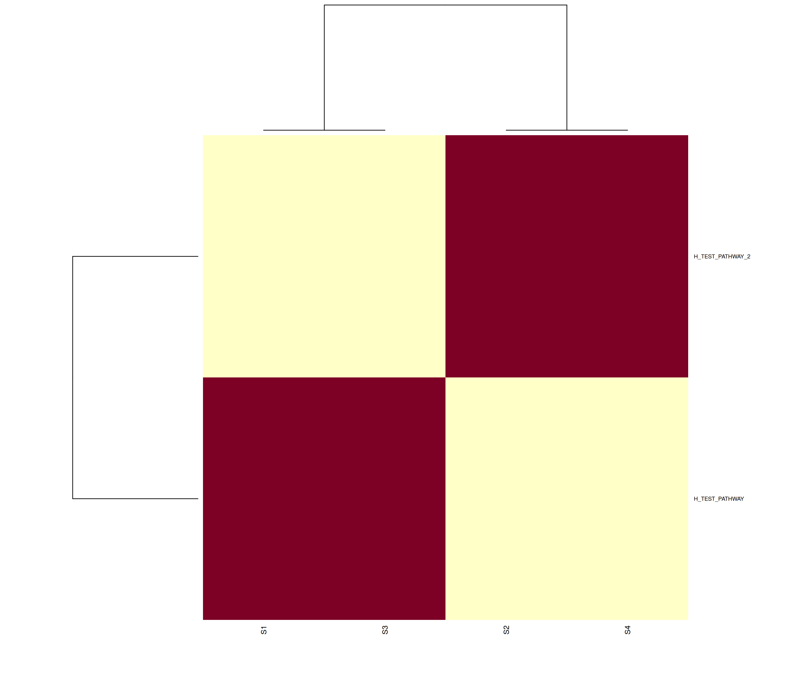

# GSVA Analysis

`gsva-analysis` is a portable application component for sample-level pathway
enrichment from normalized continuous expression. It is derived from the
canonical [OMIX GSVA](https://github.com/NIDAP-Community/OMIX/tree/main/modules/OMIX-GSVA)
module at a pinned source commit; see [OMIX_MODULE_SOURCE.md](OMIX_MODULE_SOURCE.md).

## Example output



This heatmap is generated from the small, fully synthetic fixture in
[`test_data/`](test_data/). It demonstrates the expected score-matrix layout
and clustering only; its pathway labels and values are artificial and must not
be interpreted biologically. The exact command and provenance are recorded in
[docs/README_EXAMPLE_PROVENANCE.md](docs/README_EXAMPLE_PROVENANCE.md).

## Input contract

The canonical GSVA interface requires three tables:

- normalized continuous gene-by-sample expression, where `--gene_column auto`
  selects `Gene` and then `GeneName`;
- sample metadata, with `Sample` by default; and
- pathway membership with `collection`, `gene_set_name`, `gene_symbol`, and
  `species` columns.

Raw integer counts are not valid GSVA input. Supply a normalized matrix and a
compatible pathway-membership table.

With `--collections_to_include auto` (the default), GSVA selects
`H: hallmark gene sets` for a Human pathway database and
`MH: orthology-mapped hallmark gene sets` for a Mouse pathway database.
Explicit collection names are preserved unchanged.

## Local CLI

```bash
Rscript entrypoint.R \
  --normalized_data test_data/normalized_expression.tsv \
  --sample_metadata test_data/sample_metadata.tsv \
  --pathways_database test_data/pathway_membership.tsv \
  --gene_column Gene \
  --sample_name_column Sample \
  --collections_to_include 'H: hallmark gene sets' \
  --output_dir results/example
```

The canonical interface and output definitions are in
[schemas/interface.yml](schemas/interface.yml). A successful application run
writes a self-describing bundle:

```text
<output_dir>/
├── RUN_METADATA.md
├── run_manifest.json
├── tables/gsva_results.csv
├── figures/gsva_heatmap.png
└── logs/
    ├── gsva_run_summary.txt
    └── sessionInfo.txt
```

## Container status

The published application image is available for `linux/amd64`:

```text
ghcr.io/nidap-community/gsva-analysis@sha256:c22d0fa50ea8af06e07d54fa8f03844191d5f47876e4cf72c058cba073d280f0
```

The image was built from source commit
`d5723ac526cbb5b855701ef798a59dd44e056ade`. Automated services, including
OncoChat, must use the digest rather than a mutable tag. The application image
is derived from the pinned OMIX `r-pathway` runtime. The container helper
requests `linux/amd64` explicitly (using Apple Silicon emulation when
necessary) and mounts inputs read-only at `/data` and results read-write at
`/output`.

## Run the published container

Place the three required input tables in one directory, then invoke the
digest-pinned image. The example filenames below are conventions; the CLI
paths may be changed, but they must remain beneath `/data`.

```bash
docker run --rm --platform linux/amd64 \
  --mount type=bind,src=/path/to/gsva-inputs,dst=/data,readonly \
  --mount type=bind,src=/path/to/gsva-output,dst=/output \
  ghcr.io/nidap-community/gsva-analysis@sha256:c22d0fa50ea8af06e07d54fa8f03844191d5f47876e4cf72c058cba073d280f0 \
  --normalized_data /data/normalized_expression.tsv \
  --sample_metadata /data/sample_metadata.tsv \
  --pathways_database /data/pathway_membership.tsv \
  --output_dir /output
```

For the application-level staging, parameter, output, and provenance contract,
see [docs/oncochat_adapter_contract.md](docs/oncochat_adapter_contract.md).

## Troubleshooting

| Symptom | Resolution |
| --- | --- |
| Input is raw integer counts | GSVA requires normalized, continuous expression. Normalize upstream, then provide that matrix to `--normalized_data`. |
| No samples are selected | Ensure values in the metadata sample-ID column exactly match expression matrix column names. Use `--sample_name_column` when the metadata identifier is not named `Sample`. |
| No pathways are selected | Confirm the requested species and collection names occur in the pathway-membership table. With defaults, `auto` selects Human or Mouse Hallmark collections. |
| Gene symbols do not match pathway members | Retain `--update_genes true` (the default), or provide harmonized identifiers and select the correct feature column with `--gene_column`. |
| Apple Silicon host reports a platform warning | The published image is `linux/amd64`; Docker Desktop emulates it when necessary. Keep `--platform linux/amd64` in manual Docker commands. |

For a reproducible smoke test, run
`container/smoke_test.sh gsva-analysis:d5723ac` after building the local image
or replace that image argument with the released digest.
